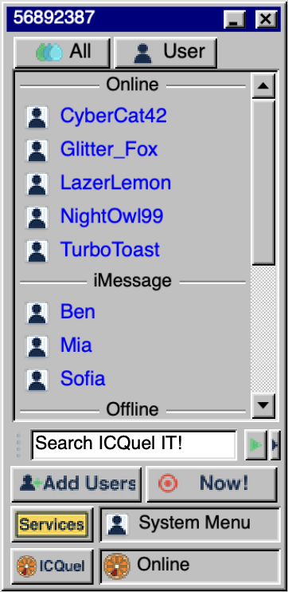
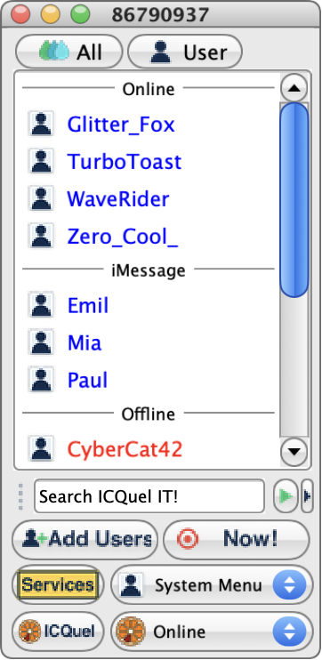
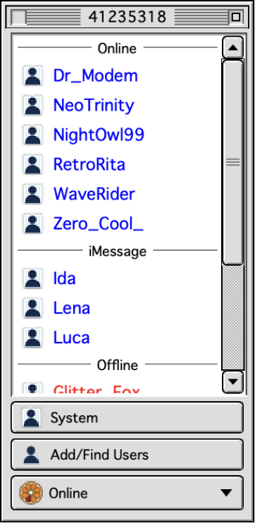
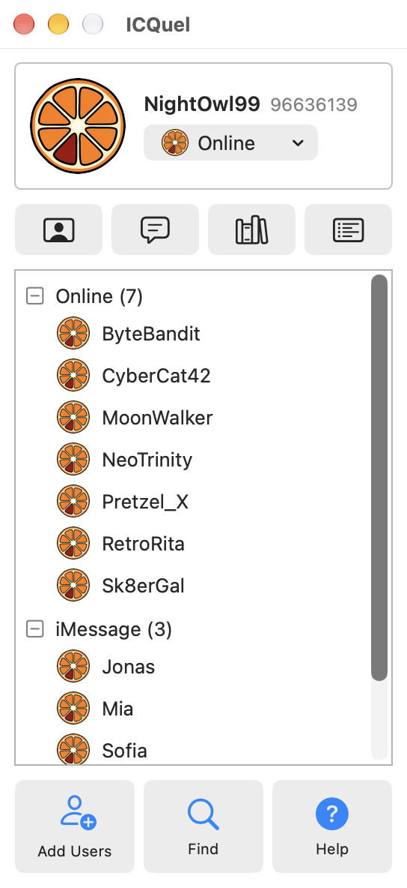

# ICQuel

A retro-styled instant-messenger companion for macOS: a native Swift/SwiftUI app that looks and feels like a late-90s messenger.
It is a local click-dummy by default (sample messages, no network). Optionally it can connect AI chatbots and your iMessage conversations.

| Windows classic | Aqua | macOS classic | Modern |
|---|---|---|---|
|  |  |  |  |

**Download:** [latest release](https://github.com/klotzbrocken/ICQuel/releases/latest) (DMG, signed and notarized; updates inside the app via Sparkle).

## Features
- Five built-in themes: Retro (Windows 98 style), Aqua, Classic Mac (Mac OS 8/9 style), Modern Mac (light/dark); resizable windows, any ID/nickname (visual only).
- Sample messages at random or fixed intervals, per-event sounds (own synthesised sounds).
- **AI chatbots** (optional, your own Anthropic or OpenAI API key, stored in the macOS keychain; the model is picked from the provider's live list): presets, assistant mode, bots that start chats on their own, always online. Optional helpers on iMessage chats: reply drafts (never sent), "What did I miss" summaries, an optional away auto-reply with guardrails, and Apple's on-device model where available.
- **Messages bridge** (optional): shows iMessage conversations (and, if you switch it on, group chats) of contacts you add, with pictures, GIFs and files, and delivered / read status of your messages. Needs Full Disk Access (read) and Automation for Messages (send); only the contacts you add are read.
- **WhatsApp** (experimental, off by default): links like WhatsApp Web through the open-source Baileys library (unofficial, WhatsApp may block accounts that use it; a second number is safer). The Node.js runtime is downloaded once, with checksum, when you switch it on.
- **Chat extras**: GIF search ([Powered by GIPHY](https://giphy.com)), pictures from the Photos library, files; Find across all messages, ActiveList, Forward, Request Chat, Random Chat (an AI chatbot with a random persona), away messages per status, contact notes; `icquel://status/dnd` lets a macOS Focus set the status.
- **Preferences > Privacy** collects every permission and every feature that sends text somewhere, with an explanation of what goes where. Preferences apply immediately.
- **Themes**: import theme packs (folder or zip with `theme.json`), see [THEMES.md](THEMES.md). Updates through Sparkle, see [UPDATES.md](UPDATES.md).
- Menu-bar item: click opens the app, right click shows status, alerts, settings, Dock icon on/off, quit.

## Build
macOS 13+, Xcode command line tools. `./build.sh` builds a universal app (ad-hoc signed). `./notarize.sh` builds with a Developer ID, notarises and staples (needs a `notarytool` keychain profile). Artwork and sounds are generated by `python3 tools/gen_assets.py`. The WhatsApp helper is bundled from `tools/wa-bridge` (needs `npm` and a network connection once; the build continues without it). `tools/test.sh` runs the logic checks, `tools/qa.sh` renders every window in all themes, [QA.md](QA.md) lists what needs a human.

## Notes
- Everything is local. The only network traffic is what you enable yourself: AI requests to the provider you picked (Anthropic or OpenAI), GIF searches (Giphy), the WhatsApp link and the one-time Node.js download (only if you switch WhatsApp on), and Sparkle update checks.
- AI chatbots play a chat friend by default and do not announce that they are an AI; use assistant mode for plain AI answers.
- ICQuel is an independent fan project. It is not affiliated with or endorsed by the owners of ICQ or any other messenger, and it ships no original assets. "Fan Made" themes that people import themselves are made by fans and are not part of this repository.
- Licence: BSD 3-Clause, see [LICENSE](LICENSE). The bundled Sparkle framework is MIT licensed (`Vendor/Sparkle/LICENSE`).
