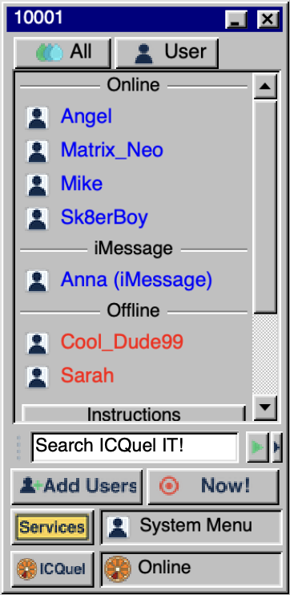
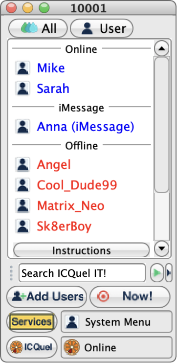
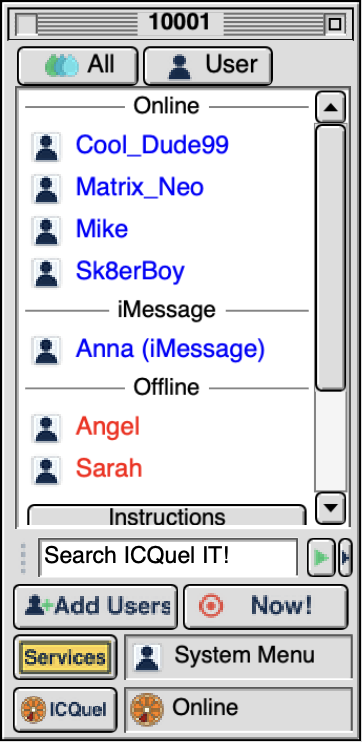
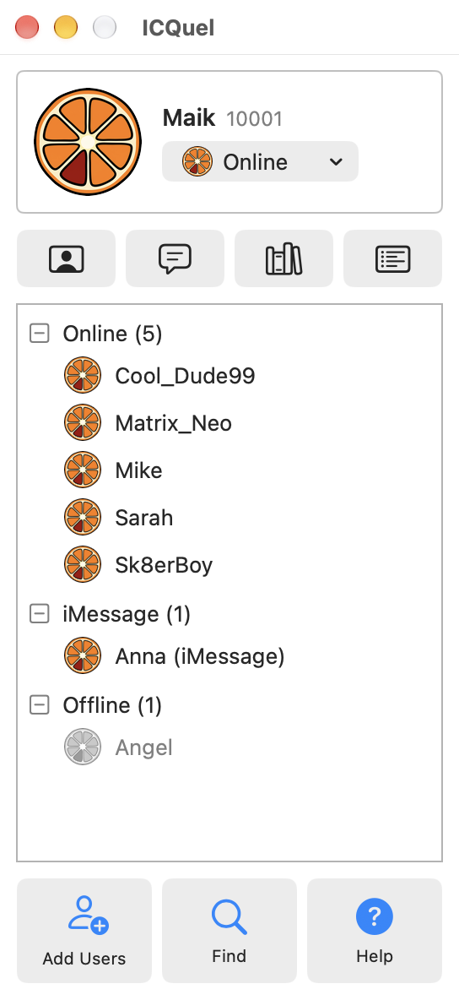

# ICQuel

A retro-styled instant-messenger companion for macOS: a native Swift/SwiftUI app that looks and feels like a late-90s messenger.
It is a local click-dummy by default (sample messages, no network). Optionally it can connect AI chatbots and your iMessage conversations.

| Retro | Aqua | Classic Mac | Modern |
|---|---|---|---|
|  |  |  |  |

## Features
- Five built-in themes: Retro (Windows 98 style), Aqua, Classic Mac (Mac OS 8/9 style), Modern Mac (light/dark); resizable windows, any ID/nickname (visual only).
- Sample messages at random or fixed intervals, per-event sounds (own synthesised sounds).
- **AI chatbots** (optional, your own Anthropic API key, stored in the macOS keychain): presets, assistant mode, bots that start chats on their own, always online.
- **Messages bridge** (optional): shows iMessage conversations of contacts you add. Needs Full Disk Access (read) and Automation for Messages (send); only the contacts you add are read.
- **Themes**: import theme packs (folder or zip with `theme.json`), see [THEMES.md](THEMES.md). Updates through Sparkle, see [UPDATES.md](UPDATES.md).
- Menu-bar item: click opens the app, right click shows status, alerts, settings, Dock icon on/off, quit.

## Build
macOS 13+, Xcode command line tools. `./build.sh` builds a universal app (ad-hoc signed). `./notarize.sh` builds with a Developer ID, notarises and staples (needs a `notarytool` keychain profile). Artwork and sounds are generated by `python3 tools/gen_assets.py`.

## Notes
- Everything is local. The only network traffic is what you enable yourself: AI requests to the Anthropic API and Sparkle update checks.
- AI chatbots play a chat friend by default and do not announce that they are an AI; use assistant mode for plain AI answers.
- ICQuel is an independent fan project. It is not affiliated with or endorsed by the owners of ICQ or any other messenger, and it ships no original assets. "Fan Made" themes that people import themselves are made by fans and are not part of this repository.
- Licence: BSD 3-Clause, see [LICENSE](LICENSE). The bundled Sparkle framework is MIT licensed (`Vendor/Sparkle/LICENSE`).
